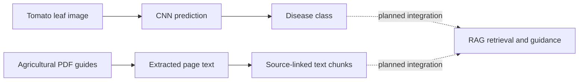

<div align="center">

# 🍅 Plant Doctor AI

### Tomato leaf disease classification and source-linked care guidance


*A student project combining image classification with an agricultural knowledge base.*

</div>

---

## 🌱 About

Plant Doctor AI uses a convolutional neural network (CNN) to classify tomato leaf images. It also prepares agricultural guides as source-linked text for a retrieval-augmented generation (RAG) system.

> **Project status:** The CNN prediction script and RAG document preparation are available. RAG retrieval and application integration are in progress.

## 🔍 Disease classes

| CNN label | Meaning |
|---|---|
| `Tomato___Early_blight` | Tomato early blight |
| `Tomato___Late_blight` | Tomato late blight |
| `Tomato___healthy` | Healthy tomato leaf |

## 🧭 Project workflow



## 🚀 Run a prediction

### 1. Install dependencies

Run this from the project root:

```bash
python -m pip install -r requirements.txt
```

### 2. Predict from an image

```bash
python cnn/predict.py path/to/leaf_image.jpg cnn/best_model.h5
```

Replace `path/to/leaf_image.jpg` with the path to your image.

## 📚 Agricultural guides

The tomato guides and their source information are in `rag/documents/tomato/` and `rag/metadata/documents.json`.

| Guide | Source |
|---|---|
| Early blight | [University of Minnesota Extension](https://extension.umn.edu/agriculture/specialty-crops/vegetable-farming/disease-management/early-blight-in-tomato-and-potato) |
| Late blight | [University of Minnesota Extension](https://extension.umn.edu/agriculture/specialty-crops/vegetable-farming/disease-management/late-blight) |
| Tomato growing and health | [Utah State University Extension](https://extension.usu.edu/yardandgarden/research/tomatoes-in-the-garden.pdf) |

## 🗂️ Project structure

| Folder or file | Purpose |
|---|---|
| `cnn/` | CNN model, class names, and prediction code |
| `rag/documents/tomato/` | Agricultural PDF guides |
| `rag/metadata/documents.json` | Guide titles, labels, and source information |
| `rag/knowledge/loader.py` | Extracts text from the PDF guides |
| `rag/data/extracted_pages.jsonl` | Extracted page text and metadata |
| `rag/data/chunks.jsonl` | Searchable, source-linked text chunks |

## ⚠️ Disclaimer

This is an educational project. Predictions can be wrong and are not a substitute for advice from a qualified agricultural expert.
